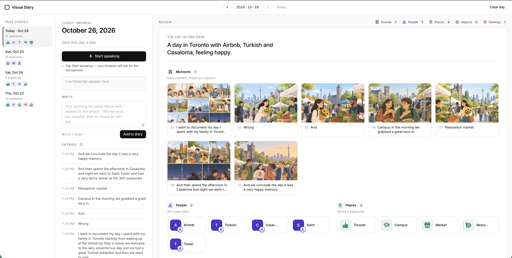
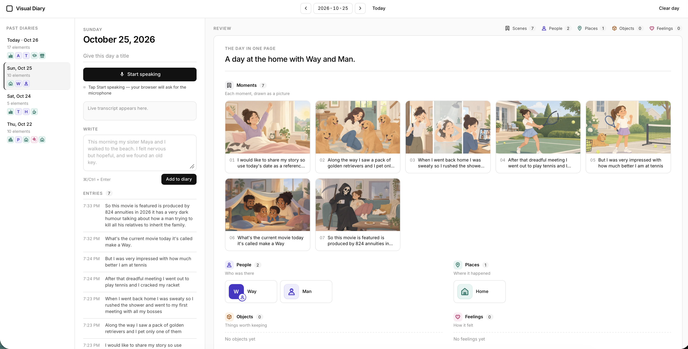
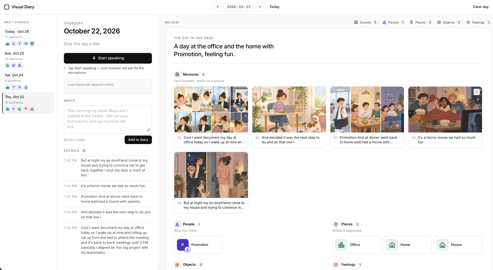

# Visual Diary

**Hackathon prompt:** *Build something that can tell your story.*

**Visual Diary** is my answer. Speak or write about your day and it turns that story into a calm **one-page review** — the **people, places, feelings, objects, and moments** you mentioned, as simple icons and AI-drawn scene pictures under a one-line summary of the day. Every day gets its own page; you can flip back through past days like a diary.

Your entries stay on your device (`localStorage`). No account to sign up for.

**Live:** https://liviaguo.github.io/grok-voicecontrolledstorytellingboard/

## Screenshots







## Run it

Requires Node.js 18+.

```bash
npm install && npm run dev
```

Then open the URL Vite prints (usually http://localhost:5173).

| Script | What it does |
| --- | --- |
| `npm run dev` | Start the dev server with hot reload |
| `npm run build` | Type-check with `tsc` and build to `dist/` |
| `npm run preview` | Serve the production build locally |
| `npm run deploy` | Build and publish `dist/` to GitHub Pages (`gh-pages` branch) |

### Browser support

Voice input uses the browser's [Web Speech API](https://developer.mozilla.org/en-US/docs/Web/API/SpeechRecognition) (`SpeechRecognition` / `webkitSpeechRecognition`). It works in Chrome, Edge and Safari; it needs microphone permission and, in Chrome, a network connection. Firefox doesn't support it yet. When voice isn't available, the app says so and you can write instead; written text builds the page the same way.

### Testing voice

Voice needs a secure page: `http://localhost` or `https://` (a plain `http://` LAN IP won't get mic access). Tapping **Start speaking** first asks for microphone permission, then starts listening; it keeps listening through short silences and Chrome's periodic cut-offs until you tap it again.

- **On your own machine (Chrome, recommended):** `npm run dev`, open http://localhost:5173, tap **Start speaking**.
  - *Allow* → speak a sentence; when you finish it (or pause), it appears on the review page. Stay silent ~10s → it should keep listening (auto-restart). Tap the mic → it stops and stays stopped.
  - *Deny* (or block via the 🔒 icon → Site settings → Microphone) → a red message explains how to re-allow, and the typed box gets focus. Re-allow, tap **Start speaking** to retry.
- **On the Grok Bot box desktop:** there's usually no real microphone, so expect the "No microphone was found" / blocked path. Use it to check the error + typed-fallback flow, not recognition quality.
- **Typed fallback:** always available — type in the **Write** box and press *Add to diary* (or Ctrl/⌘+Enter).

Browsers without `SpeechRecognition` (e.g. Firefox) get typed-first guidance. A MediaRecorder + server transcription fallback is a possible later addition; it isn't built.

## How it works

1. **Pick a day.** The app opens on today. Use ‹ › , the date picker, **Today**, or the **Past diaries** list to switch days. The URL hash (`#2026-10-26`) links straight to a day.
2. **Speak or write.** Nothing is added mid-phrase: speech is buffered until a sentence is finished (it ends in . ! ? or you pause for ~1.6 s), then that whole sentence is parsed. Each *Add to diary* is treated as finished sentences. Each is saved as an entry for that day.
3. **Parse.** A rule-based parser (`src/parser/parser.ts`) pulls out:
   - *People*: "my sister Maya" → **Maya** (my sister), "named Alex", capitalised names
   - *Places*: beach, park, cafe, office… and cities like Toronto
   - *Feelings*: nervous, hopeful, grateful, tired…
   - *Objects*: "an old key", "my camera", coffee, flowers…
   - *Scenes*: every entry gets at least one moment (sentences with time cues like "this morning" become their own scenes)
   - *Explicit*: start a sentence with `person:`, `place:`, `feeling:`, `object:` or `scene:`.
4. **Review.** The day renders as one page: a summary line ("A day in Toronto with Maya, feeling hopeful — and an old key to remember."), numbered Moments, then People / Places / Objects / Feelings as icon tiles (Lucide icons; named people get a monogram). Everything flows in sections — no free positioning, so no gaps. × or Delete removes an item.
5. **Persist.** All days are saved in `localStorage` under `visual-diary:v2` as `{ version: 2, diaries: { "YYYY-MM-DD": { title, elements, entries, updatedAt } } }`. Boards from the earlier single-board version are migrated automatically.

### Images

- **Moment pictures (visual telling)** — each Moment is drawn by OpenAI `gpt-image-2.5` (quality low, 1536×1024 WebP) through the tiny proxy in [`proxy/`](proxy/server.mjs), which holds `OPENAI_API_KEY` server-side; the key is never in the frontend or this repo. A new scene stores a pending ref; once the proxy returns the picture, its data URL replaces the ref on the scene in localStorage, so revisiting a day shows it instantly. Loads are queued (2 at a time) with 2 retries; on failure the Moment shows its icon and a *Retry picture* button. First draw takes ~10–15 s.

### Image proxy (demo setup)

- Proxy API: `POST /api/scene-image { scene, places?, feelings? }` → `{ image: "data:image/webp;base64,…" }`; `GET /health`. CORS allows `https://liviaguo.github.io` and `localhost`. Light per-IP rate limit (12/min) and 4 concurrent generations.
- The Pages build points at `VITE_IMAGE_API_BASE` from `.env.production` (currently `https://visual-diary-livia.tunl.cc`, a free tunl.cc tunnel to the box).
- Start / restart proxy + tunnel (box, with `OPENAI_API_KEY` exported): `./scripts/demo-proxy.sh`. Logs: `/workspace/vd-proxy/`. It requests the same fixed subdomain, so the deployed site keeps working after a restart.
- If the public URL ever changes, open the app once with `?api=<new URL>` (remembered in that browser), or put it in `.env.production` and `npm run deploy`.
- Local dev: `cd proxy && OPENAI_API_KEY=… npm start`, then `npm run dev` (defaults to `http://localhost:8787`).
- The box and tunnel must stay up during the demo; if images stop, run the script again.

Visuals are bundled locally so the page renders instantly, with no network at runtime:

- **Icons (shown)** — [Lucide](https://lucide.dev) (ISC): every person, place, object, feeling and moment is a simple icon; named people get a monogram.
- **Photos (not shown for now)** — small CC0 photos from [StockSnap](https://stocksnap.io) (via the [Openverse](https://openverse.org) API) in `src/assets/photos/`, ~20 KB each. Sources are in `src/assets/photos/credits.json`. Refresh or extend with `python3 scripts/fetch_assets.py` (needs Pillow); edit `TOPICS` there to add keywords.

## Project structure

```
index.html
vite.config.ts       # base: './' so the build works on GitHub Pages
scripts/fetch_assets.py  # one-off CC0 photo downloader
src/
  main.ts            # App shell: date navigation, history, voice + sentence gate, parser, review, storage
  style.css          # Minimal light theme
  types.ts           # DiaryDay / DiaryStore / StoryElement types, date helpers
  voice/voice.ts     # Web Speech API wrapper (mic priming, auto-restart, errors/retry)
  voice/speech.d.ts  # Minimal Web Speech API typings
  parser/parser.ts   # Rule-based text → diary elements (+ asset keywords)
  visuals/visuals.ts # Element → icon / monogram
  review/review.ts   # One-page review: summary, moments, icon sections
  storage/storage.ts # localStorage load/save, v1 migration
  assets/photos/     # CC0 photos + credits.json (kept for a future cover image)
```

## What's next

- Smarter parsing with an LLM (better entity extraction, summaries)
- Generated images per scene, or your own photos
- Calendar heat-map of past days; search across diaries
- Export a day as an image or PDF
- Optional sync across devices

## Parser checks

`npm run test:parser` runs unit-style checks (tests/parser.check.ts) for the Maya/beach and Toronto sentences, sentence-initial names, the sentence gate and the summary line.
